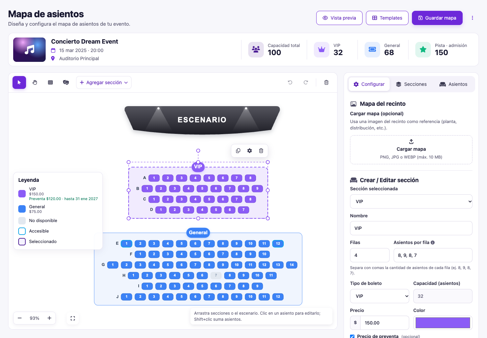

# ticket-map-js
an small sdk function to configure the map for ticket selling 

## Dream Event Seating

Editor de mapas de asientos y componente de compra (escritorio + móvil con detección automática), sin backend ni compilación.



- [Inicio rápido y archivos](dream-event-seating/README.md)
- [Guía del Builder](dream-event-seating/docs/GUIA-BUILDER.md): secciones, templates, preventa, atajos y API.
- [Guía de compra](dream-event-seating/docs/GUIA-COMPRA.md): escritorio, móvil, detección automática, reservas y API.
- [Esquema JSON](dream-event-seating/JSON-SCHEMA.md)

## Format JavaScript and CSS

Install the development dependency once, then run the formatter from the repository root:

```sh
bun install
bun format
```

`bun format` uses Prettier to expand compressed/minified JavaScript and CSS into readable source formatting. To check formatting without changing files, run `bun format:check`.
