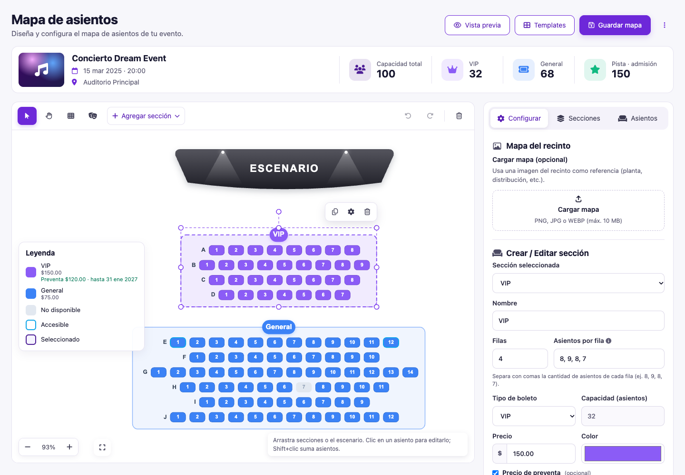
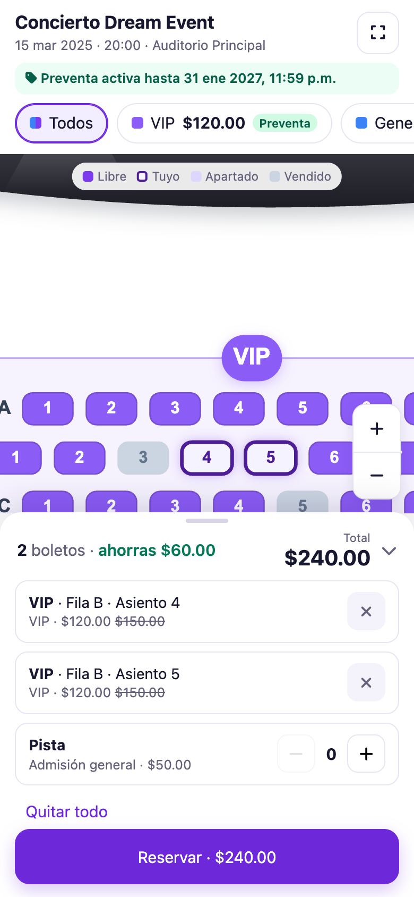
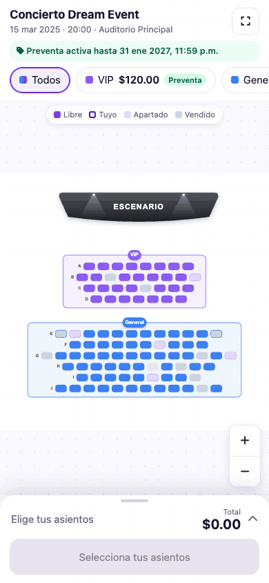

# Dream Event Seating

Componentes de navegador para **diseñar mapas de asientos** y **vender boletos sobre ellos**. Funcionan sin backend, sin npm y sin compilación: solo archivos JS/CSS y un JSON con el mapa.

| Componente | Para quién | Qué hace |
| --- | --- | --- |
| **Builder** (`DreamEventSeatMapBuilder`) | Organizador | Diseña el recinto: secciones, filas, asientos, escenario, precios, preventa y templates. Produce el JSON del mapa. |
| **Compra** (`DreamEventSeatPicker`) | Comprador | Muestra el mapa, deja elegir asientos, calcula el total (con preventa) y hace una reserva simulada. Elige solo la versión **escritorio** (PC, iPad) o **móvil** (teléfono). |



<p align="center">
  
  &nbsp;
  
</p>

## Guías

- **[Guía del Builder](docs/GUIA-BUILDER.md)**: instalación, cada pestaña y herramienta, templates, preventa, atajos, API y callbacks.
- **[Guía de compra (escritorio y móvil)](docs/GUIA-COMPRA.md)**: detección automática, flujo del comprador, disponibilidad, reservas, API y callbacks.
- **[Esquema JSON](JSON-SCHEMA.md)**: formato del mapa y lista de métodos.

## Inicio rápido (5 minutos)

1. Sirve esta carpeta con cualquier servidor estático:

   ```sh
   cd dream-event-seating
   python3 -m http.server 8080
   ```

2. Abre las demos:

   | URL | Qué muestra |
   | --- | --- |
   | `http://localhost:8080/builder-demo.html` | Builder con el ejemplo del concierto |
   | `http://localhost:8080/selector-demo.html` | Compra con selector de mapa/template y de vista (auto, escritorio, móvil) |
   | `http://localhost:8080/` | Builder + compra + inspector JSON en pestañas |
   | `http://localhost:8080/tests/` | Pruebas en navegador |

3. Copia a tu proyecto la carpeta `js/` y `css/` y sigue la guía del componente que necesites.

### Builder en tu página

```html
<link rel="stylesheet" href="https://cdnjs.cloudflare.com/ajax/libs/font-awesome/6.7.2/css/all.min.css">
<link rel="stylesheet" href="css/dream-event-builder.css">

<div id="builder"></div>

<script src="https://cdn.jsdelivr.net/npm/sweetalert2@11"></script>
<script src="https://cdn.jsdelivr.net/npm/konva@9.3.18/konva.min.js"></script>
<script src="js/dream-event-utils.js"></script>
<script src="js/dream-event-schema.js"></script>
<script src="js/dream-event-layout.js"></script>
<script src="js/dream-event-history.js"></script>
<script src="js/dream-event-renderer.js"></script>
<script src="js/dream-event-templates.js"></script>
<script src="js/dream-event-seat-map-builder.js"></script>
<script>
  const builder = new DreamEventSeatMapBuilder({
    container: '#builder',
    data: mapaGuardado, // o {} para empezar vacío / con un template
    callbacks: { onComplete: (mapa) => fetch('/api/mapa', { method: 'POST', body: JSON.stringify(mapa) }) },
  });
</script>
```

### Compra en tu página (detecta móvil o escritorio)

```html
<link rel="stylesheet" href="https://cdnjs.cloudflare.com/ajax/libs/font-awesome/6.7.2/css/all.min.css">
<link rel="stylesheet" href="https://cdn.jsdelivr.net/npm/bootstrap@5.3.3/dist/css/bootstrap.min.css">
<link rel="stylesheet" href="css/dream-event-common.css">
<link rel="stylesheet" href="css/dream-event-selector.css">
<link rel="stylesheet" href="css/dream-event-mobile.css">

<div id="compra"></div>

<script src="https://cdn.jsdelivr.net/npm/sweetalert2@11"></script>
<script src="https://cdn.jsdelivr.net/npm/konva@9.3.18/konva.min.js"></script>
<script src="js/dream-event-utils.js"></script>
<script src="js/dream-event-schema.js"></script>
<script src="js/dream-event-layout.js"></script>
<script src="js/dream-event-renderer.js"></script>
<script src="js/dream-event-seat-selector.js"></script>
<script src="js/dream-event-seat-selector-mobile.js"></script>
<script>
  const compra = DreamEventSeatPicker.create({
    container: '#compra',
    data: mapa,                                // el JSON que produjo el Builder
    availability: { seats: { seat_a1: 'sold' }, generalAdmission: {} },
    options: { maxSeats: 6 },
    callbacks: { onHoldCreated: (reserva) => console.log(reserva) },
  });
</script>
```

## Qué hay en cada archivo

| Archivo | Uso |
| --- | --- |
| `js/dream-event-utils.js` | Utilidades, dinero y precio vigente (preventa). |
| `js/dream-event-schema.js` | Valores por defecto, normalización y validación del JSON. |
| `js/dream-event-layout.js` | Geometría: filas rectas, curvas, semicírculos, anillos y mesas. |
| `js/dream-event-history.js` | Deshacer/rehacer (solo Builder). |
| `js/dream-event-renderer.js` | Dibujo Konva compartido: chips de asientos, zoom, pellizco, selección. |
| `js/dream-event-templates.js` | 12 recintos prediseñados (opcional, solo Builder). |
| `js/dream-event-seat-map-builder.js` | Builder. |
| `js/dream-event-seat-selector.js` | Compra en escritorio (`DreamEventSeatSelector`). |
| `js/dream-event-seat-selector-mobile.js` | Compra móvil (`DreamEventSeatSelectorMobile`) y detector automático (`DreamEventSeatPicker`). |
| `css/dream-event-builder.css` | Estilos del Builder (`.deb`). |
| `css/dream-event-common.css`, `css/dream-event-selector.css` | Estilos de compra en escritorio. |
| `css/dream-event-mobile.css` | Estilos de compra móvil (`.dem`). |
| `examples/` | Mapas de ejemplo (`concert.json` con preventa, `large-venue.json` con 1,000 asientos, etc.). |
| `docs/` | Guías, capturas (`docs/images/`) y el script que las regenera (`docs/tools/capture.mjs`). |

## Dependencias

Por CDN: Konva 9.3.18 (obligatoria), SweetAlert2 11 (confirmaciones del Builder y avisos en escritorio; el Builder funciona sin ella con `confirm()` nativo), Font Awesome 6.7.2 (iconos) y Bootstrap 5.3.3 (solo la compra en escritorio). Puedes descargarlas y servirlas localmente.

## Dinero y seguridad

- `ticketTypes[].price` y `presalePrice` están en unidades mayores (`1500` = $1,500 MXN). Los totales se suman en centavos enteros.
- La reserva es **simulada y local**: no bloquea asientos para otros compradores ni cobra. El navegador no es autoridad sobre precios, fechas de preventa, disponibilidad ni pagos: tu servidor debe validar y cobrar.
- `availability` (vendido/apartado) va separado del mapa; se actualiza con `setAvailability()` o `updateSeatStatus()`.

## Pruebas

```sh
node tests/run.js
```

## Regenerar capturas y GIFs

Con el servidor en marcha y Chrome + ffmpeg instalados:

```sh
node docs/tools/capture.mjs
```
