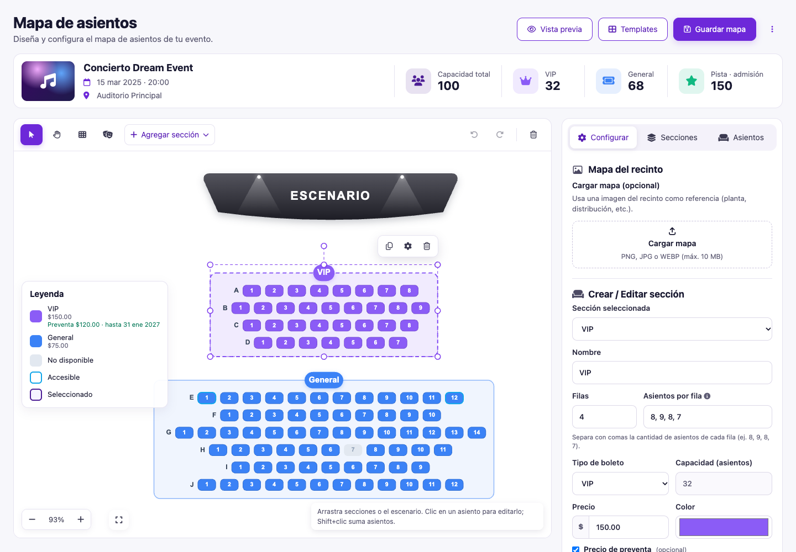
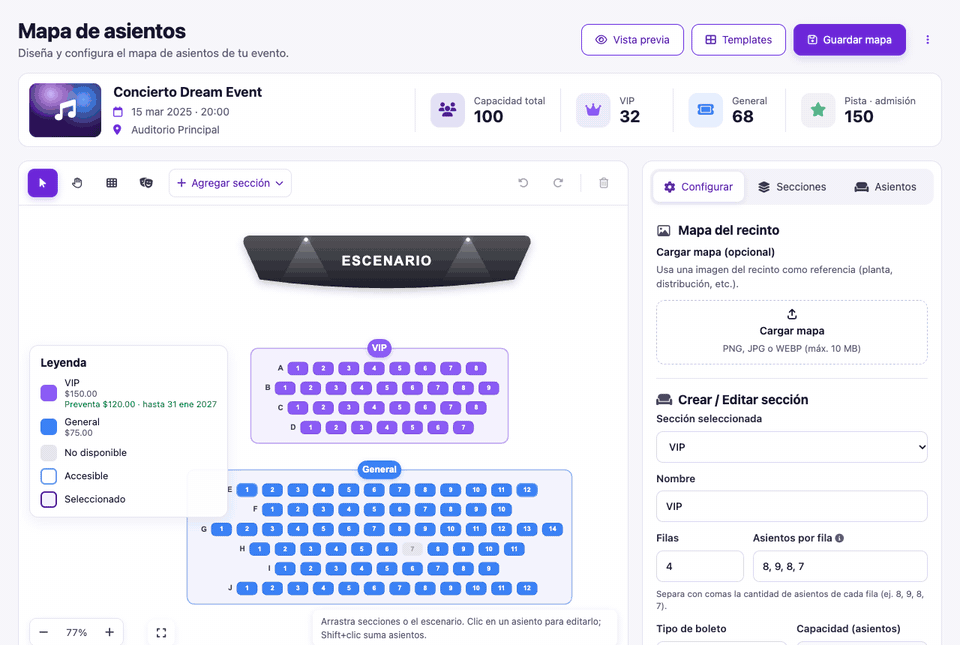
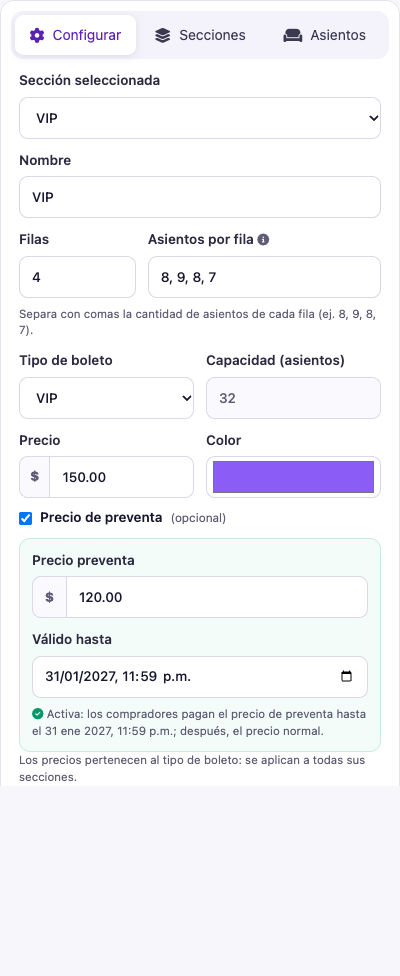
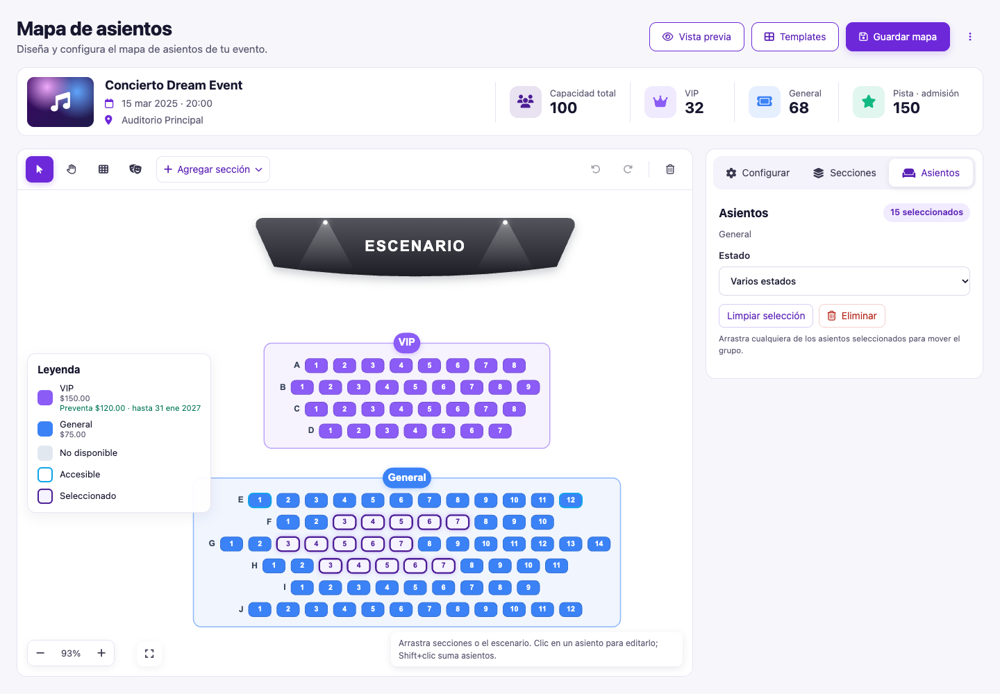
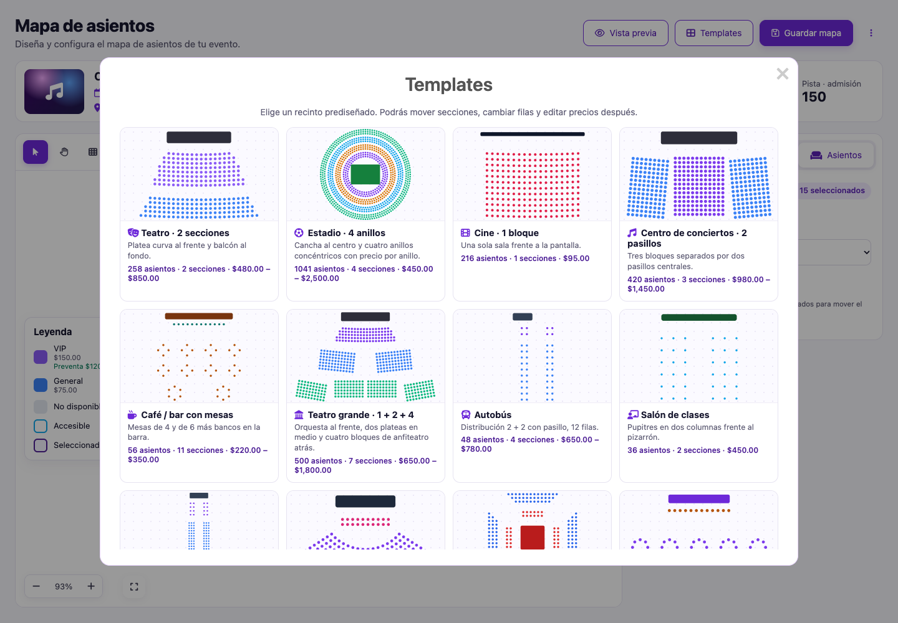
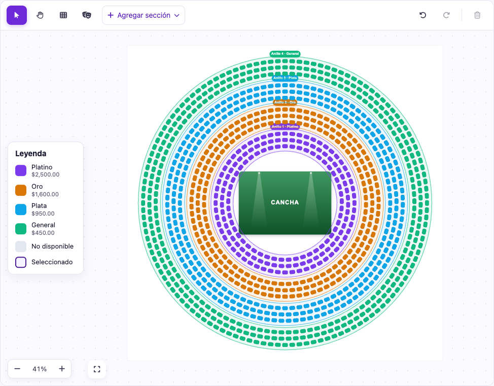
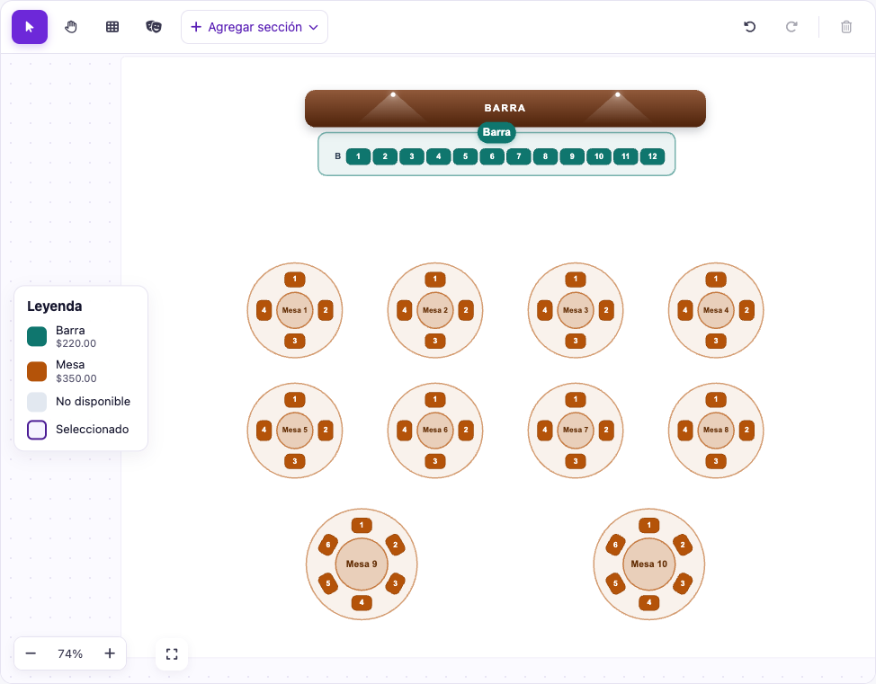
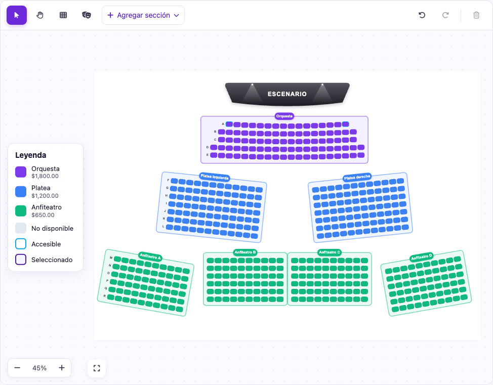
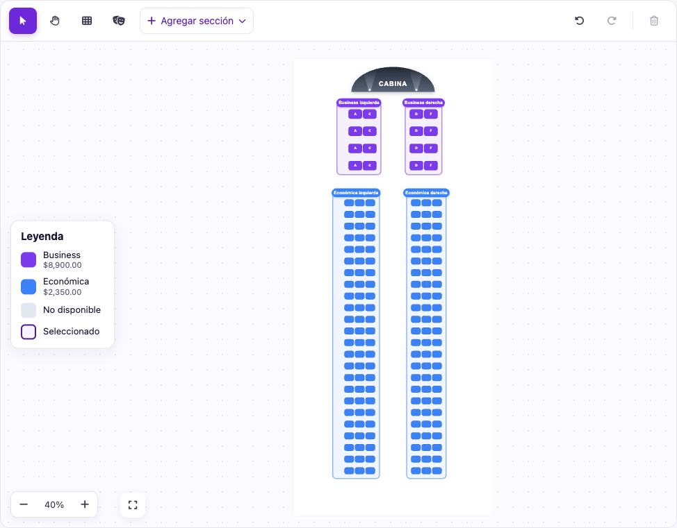

# Guía del Builder (`DreamEventSeatMapBuilder`)

El Builder es el editor del organizador. Con él se diseña el recinto y se obtiene un **JSON del mapa** que después consume el componente de compra.





---

## 1. Instalación

```html
<link rel="stylesheet" href="https://cdnjs.cloudflare.com/ajax/libs/font-awesome/6.7.2/css/all.min.css">
<link rel="stylesheet" href="css/dream-event-builder.css">

<div id="builder"></div>

<script src="https://cdn.jsdelivr.net/npm/sweetalert2@11"></script>          <!-- opcional -->
<script src="https://cdn.jsdelivr.net/npm/konva@9.3.18/konva.min.js"></script> <!-- obligatoria -->
<script src="js/dream-event-utils.js"></script>
<script src="js/dream-event-schema.js"></script>
<script src="js/dream-event-layout.js"></script>
<script src="js/dream-event-history.js"></script>
<script src="js/dream-event-renderer.js"></script>
<script src="js/dream-event-templates.js"></script>       <!-- opcional: botón Templates -->
<script src="js/dream-event-seat-selector.js"></script>   <!-- opcional: «Vista previa» en modal -->
<script src="js/dream-event-seat-map-builder.js"></script>
```

El orden importa: utilidades → esquema → layout → historial → renderer → (templates) → Builder.

```js
const builder = new DreamEventSeatMapBuilder({
  container: '#builder',          // selector o elemento
  data: mapa,                     // JSON del mapa; {} para empezar vacío
  options: {
    locale: 'es-MX',
    currency: 'MXN',
    historyLimit: 50,             // pasos de deshacer
    keyboard: true,               // atajos de teclado
    templates: [],                // templates propios (ver §6); false oculta el botón
  },
  callbacks: {
    onReady(mapa) {},
    onChange(mapa) {},            // cada cambio (guardar borrador)
    onComplete(mapa) {},          // «Guardar mapa» tras validar y confirmar
    onValidationError(errores) {},
    onSelectionChange(seleccion) {},
    onStepChange(pestaña) {},
    onTemplateLoaded({ id, data }) {},
    onPreview(json) {},           // si existe, sustituye la vista previa en modal
    onReset() {},
    onError(error) {},
  },
});
```

El contenedor puede tener cualquier ancho; en pantallas menores a 1100 px el panel lateral pasa debajo del mapa.

---

## 2. Recorrido por la pantalla

| Zona | Uso |
| --- | --- |
| Encabezado | **Vista previa** (abre la compra con el mapa actual), **Templates**, **Guardar mapa** y menú ⋮ (exportar/importar JSON, ajustar vista, restaurar, vaciar). |
| Resumen | Nombre, fecha y lugar (`metadata.date`, `metadata.venue`), capacidad total y asientos por tipo de boleto. |
| Barra del mapa | Herramientas, **Agregar sección ▾**, deshacer/rehacer y eliminar selección. |
| Mapa | Lienzo con zoom, leyenda de precios y barra flotante de la sección seleccionada. |
| Panel | Pestañas **Configurar**, **Secciones** y **Asientos**. |

### Herramientas

| Botón | Atajo | Qué hace |
| --- | --- | --- |
| Flecha | `V` | Seleccionar y mover. Clic en sección o escenario → controles para mover, escalar y rotar. Clic en asiento → lo selecciona. Arrastrar el fondo → mueve la vista. |
| Mano | `H` | Solo mover la vista. |
| Cuadrícula | `M` | Recuadro para seleccionar muchos asientos (Shift suma). |
| Máscaras | — | Agrega el escenario si no existe y lo selecciona. |
| Agregar sección ▾ | — | Crea una sección con forma predefinida debajo de lo existente, o abre el formulario («Personalizada…»). |

Zoom con la rueda del ratón o con − / + (el porcentaje es real); el botón ⤢ ajusta la vista.

### Atajos de teclado

| Atajo | Acción |
| --- | --- |
| `Ctrl/⌘ + Z` · `Ctrl/⌘ + Shift + Z` (o `Ctrl + Y`) | Deshacer · Rehacer |
| `Supr` / `Backspace` | Eliminar lo seleccionado (pide confirmación) |
| `Esc` | Limpiar selección |
| Flechas (`Shift` = 10 px) | Mover sección o escenario seleccionado |
| `Ctrl/⌘ + D` | Duplicar sección |

Los atajos se ignoran mientras escribes en un campo.

---

## 3. Pestaña Configurar



**Mapa del recinto.** Sube una imagen (PNG/JPG/WEBP, máx. 10 MB) para calcar encima. Ajusta la opacidad, usa «Ajustar al plano» o quítala. Se guarda como Data URL en `background.src`.

**Crear / Editar sección.**

1. *Sección seleccionada*: elige una existente o «＋ Nueva sección». Hacer clic en una sección del mapa también la elige.
2. *Filas* y *Asientos por fila*: escribe la cantidad de cada fila separada por comas (`8, 9, 8, 7`). Si cambias *Filas*, la lista se alarga o recorta sola. La *Capacidad* se calcula.
3. *Tipo de boleto*: cualquier tipo con `mode: "reserved_seating"` del JSON.
4. *Precio* y *Color*. El precio pertenece al tipo de boleto, así que cambia en todas sus secciones.
5. *Precio de preventa (opcional)*: ver §5.
6. *Forma y espaciado*: forma, alineación, tamaño de asiento, separaciones, curvatura y radio interior (anillos y mesas).
7. **Aplicar cambios a la sección** (o **Crear sección**).

Al editar, los asientos que siguen existiendo conservan su `id`. Las filas nuevas continúan el abecedario del mapa sin repetir letras.

**Escenario (opcional).** Etiqueta, forma (rectangular, trapezoidal, semicircular, cuadrado, circular), color, tamaño, rotación y bloqueo. También se mueve y redimensiona en el mapa. `stage: null` significa sin escenario (p. ej. un avión).

<br clear="right">

### Formas de sección

| Forma | Uso típico |
| --- | --- |
| Rectangular / Cuadrada | Plateas, bloques de cine. |
| Trapezoidal | Bloques que se abren hacia atrás. |
| Semicircular | Gradas en abanico (cada fila es un arco concéntrico). |
| Circular | Contorno elíptico alrededor de las filas. |
| **Anillo** (`ring`) | Estadios: cada fila es un círculo completo alrededor del centro de la sección. `innerRadius` = radio de la primera fila. |
| **Mesa redonda** (`table`) | Cafés y banquetes: asientos alrededor de una mesa con su nombre. |

---

## 4. Pestañas Secciones y Asientos

**Secciones**: lista con seleccionar, ocultar (👁), bloquear (🔒), configurar, duplicar y eliminar.

**Asientos**: aparece al seleccionar asientos en el mapa.



- Un asiento: editar etiqueta y número (no se permiten números repetidos en la fila).
- Varios: estado en bloque (**Disponible**, **No disponible**, **Bloqueado**, **Accesible**).
- **Seleccionar fila**, **Restablecer posición** (si moviste asientos a mano) y **Eliminar** (las filas que quedan vacías se quitan).
- Arrastra cualquier asiento seleccionado para mover todo el grupo; quedan con `manualPosition: true`.

---

## 5. Precio de preventa

Cada tipo de boleto puede tener un segundo precio válido hasta una fecha:

```json
{ "id": "ticket_vip", "price": 150, "presalePrice": 120, "presaleEndsAt": "2027-01-31T23:59:00-06:00" }
```

- Se activa con la casilla **Precio de preventa (opcional)** del formulario. «Válido hasta» usa fecha y hora local y se guarda en ISO 8601 (UTC).
- La leyenda del mapa muestra ambos precios y si la preventa sigue activa.
- Validación: preventa ≥ 0, no mayor que el precio normal y con fecha válida. `presaleEndsAt` también acepta `"YYYY-MM-DD"` (hasta el final de ese día).
- Al desmarcar la casilla, ambos campos quedan en `null`.

---

## 6. Templates



El botón **Templates** abre una galería con vista previa. Al elegir uno se reemplazan secciones, escenario y tipos de boleto, pero se conservan `eventId`, nombre, moneda y `metadata` del evento. Se puede deshacer con `Ctrl/⌘ + Z`. Todo queda editable.

| Template (`id`) | Distribución | Asientos | Precios sugeridos (MXN) |
| --- | --- | --- | --- |
| Teatro · 2 secciones (`theater-2`) | Platea curva + balcón | 258 | $850 / $480 |
| Estadio · 4 anillos (`stadium-4`) | Cancha + Platino, Oro, Plata, General | 1,041 | $2,500 / $1,600 / $950 / $450 |
| Cine · 1 bloque (`cinema`) | Una sala | 216 | $95 |
| Centro de conciertos (`concert-aisles`) | 3 bloques con 2 pasillos centrales | 420 | $1,450 / $980 |
| Café / bar (`cafe-bar`) | Barra + 10 mesas de 4 y 6 | 56 | $350 / $220 |
| Teatro grande · 1 + 2 + 4 (`grand-theater`) | Orquesta, 2 plateas, 4 anfiteatros | 500 | $1,800 / $1,200 / $650 |
| Autobús (`bus`) | 2 + 2, Premium y Ejecutivo | 48 | $780 / $650 |
| Salón de clases (`classroom`) | 2 columnas de pupitres | 36 | $450 |
| Avión (`airplane`) | Business 2 + 2, Económica 3 + 3 | 160 | $8,900 / $2,350 |
| Auditorio en abanico (`fan-auditorium`) | Preferente + gradas semicirculares | 174 | $650 / $400 |
| Arena · ring central (`arena`) | Ringside y gradas en 4 lados | 192 | $3,200 / $950 |
| Salón de banquetes (`banquet`) | Mesa de honor + 10 mesas de 8 | 92 | $1,500 / $1,200 |

| Estadio | Café / bar | Teatro grande | Avión |
| --- | --- | --- | --- |
|  |  |  |  |

### Templates propios

```js
new DreamEventSeatMapBuilder({
  container: '#builder',
  data: {},
  options: {
    templates: [
      {
        id: 'mi-foro',                       // si coincide con uno integrado, lo reemplaza
        name: 'Mi foro',
        icon: 'fa-solid fa-star',
        description: 'Foro con 2 bloques',
        build: () => miMapaJSON,             // o data: miMapaJSON
      },
    ],
  },
});
```

Fuera del Builder: `DreamEventTemplates.list()`, `DreamEventTemplates.get(id)` (JSON nuevo cada vez) y `DreamEventTemplates.preview(mapa)` (miniatura SVG).

---

## 7. Guardar, validar y pasar el mapa a la compra

«Guardar mapa» valida (IDs únicos, tipos de boleto existentes y con asiento reservado, filas no vacías, números no repetidos, coordenadas válidas, preventa coherente, capacidad). Si hay errores los lista; si no, pide confirmación y llama a `onComplete(mapa)`.

```js
const errores = builder.validate();   // [] si todo está bien
const mapa = builder.getData();       // objeto (copia)
const texto = builder.getJSON();      // string con formato
// ...guárdalo en tu servidor y úsalo en DreamEventSeatPicker (ver guía de compra)
```

---

## 8. API

| Método | Descripción |
| --- | --- |
| `getData()` / `getJSON()` / `setData(json)` | Leer o reemplazar el mapa (`setData` se puede deshacer). |
| `getCapacity()`, `getTicketTypes()`, `getSections()`, `getSection(id)`, `getSeats()` | Consultas. |
| `addSection(s)`, `updateSection(id, cambios)`, `duplicateSection(id)`, `removeSection(id, { confirm })` | Secciones. |
| `addRow`, `updateRow`, `removeRow` | Filas. |
| `updateSeat(id, cambios)`, `updateSeats(ids, cambios)`, `removeSeat(id)`, `removeSeats(ids, { confirm })` | Asientos. |
| `setStage(datos \| null)`, `setBackground(datos)` | Escenario y plano. |
| `select({ type: 'section', id } \| { type: 'stage' } \| null)`, `selectSection(id)`, `selectSeats(ids)`, `getSelectedElement()`, `deleteSelection()` | Selección. |
| `setTool('select' \| 'pan' \| 'marquee' \| 'stage')`, `goToStep(0-2)` | Herramienta y pestaña. |
| `applySectionForm()` | Aplica el formulario de sección. |
| `openTemplates()`, `loadTemplate(id)` | Templates. |
| `validate()`, `undo()`, `redo()`, `reset({ confirm })`, `clear()` | Estado. |
| `fitToMap()`, `fitToScreen()`, `resize()`, `destroy()` | Vista y ciclo de vida. |

Las acciones destructivas (`removeSection`, `removeSeats`, `reset`) piden confirmación; pasa `{ confirm: false }` para hacerlo desde código.
