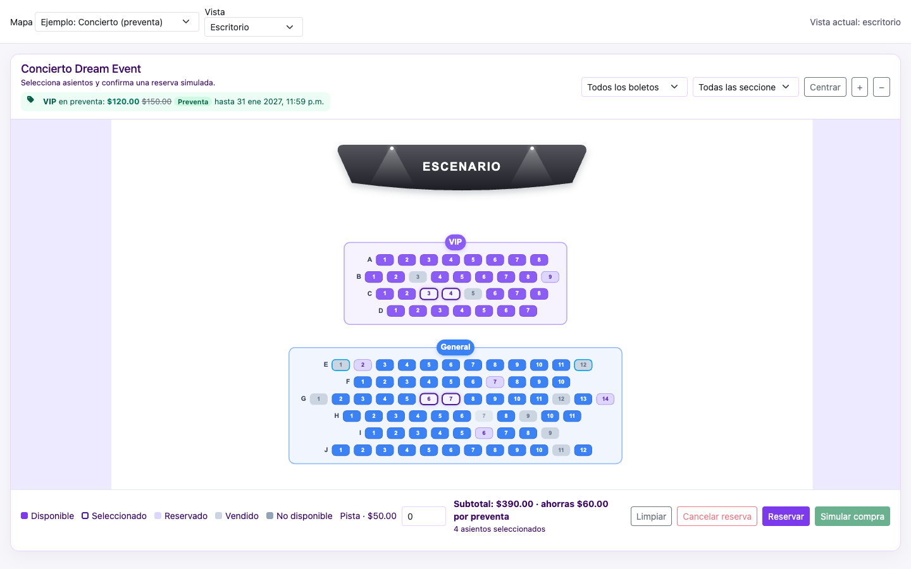
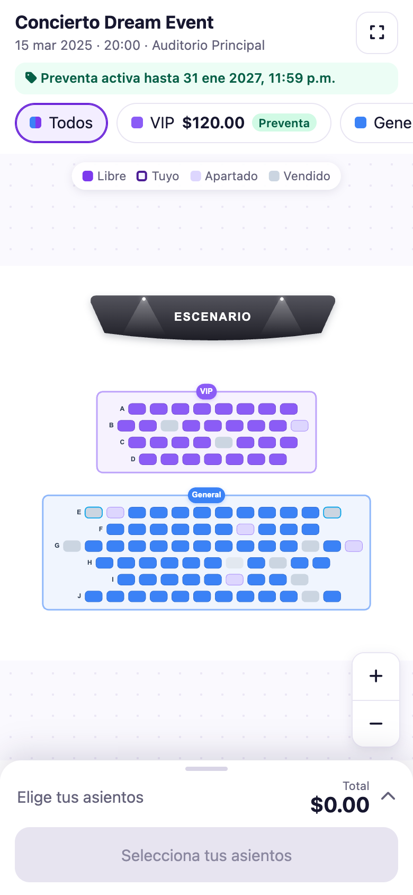
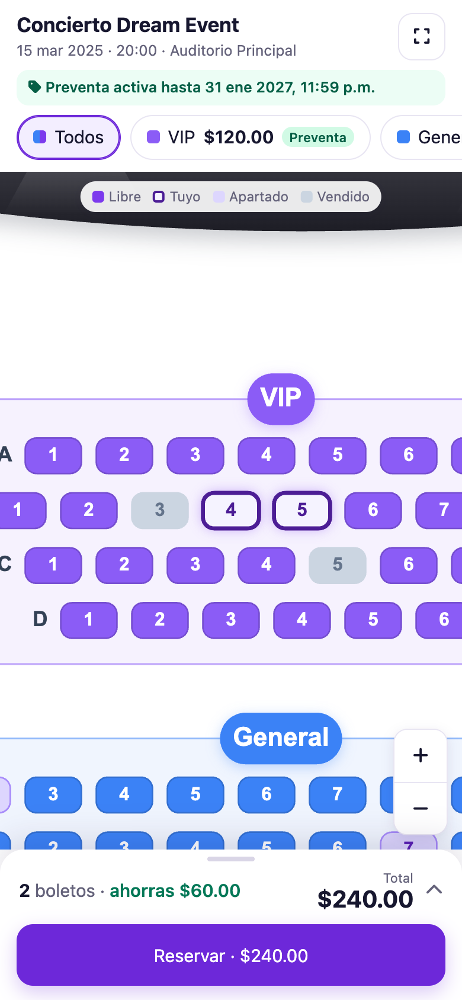
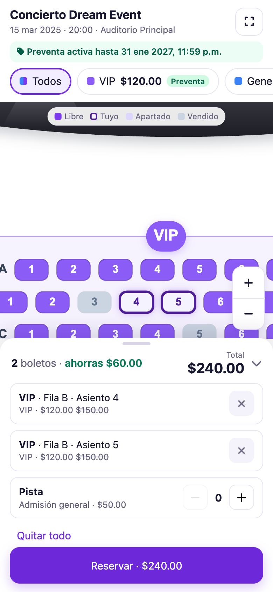
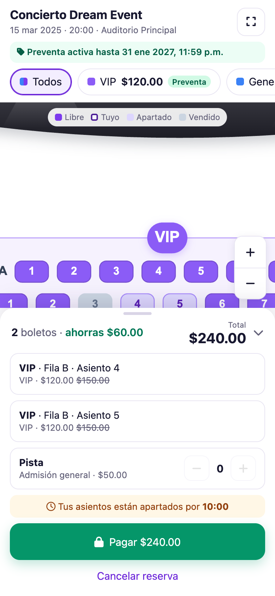
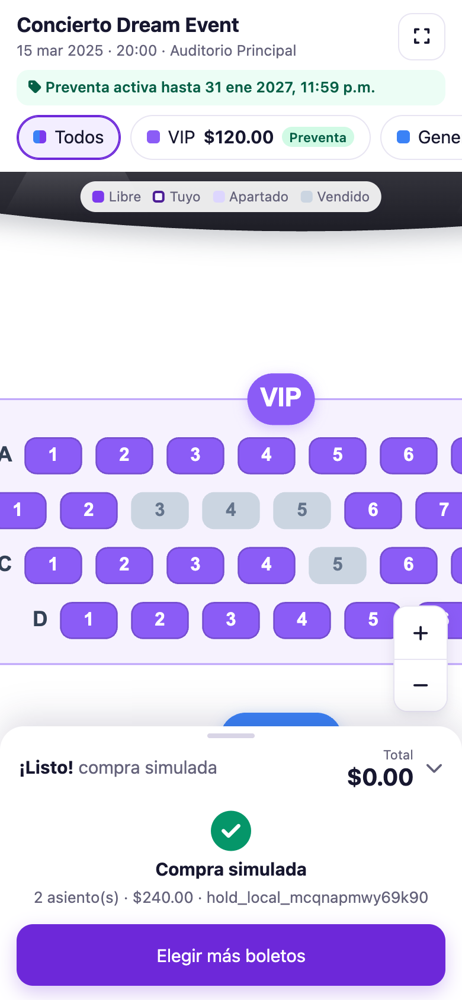
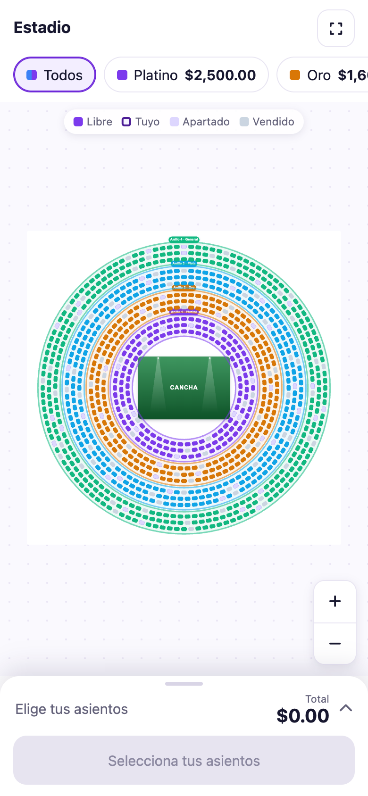
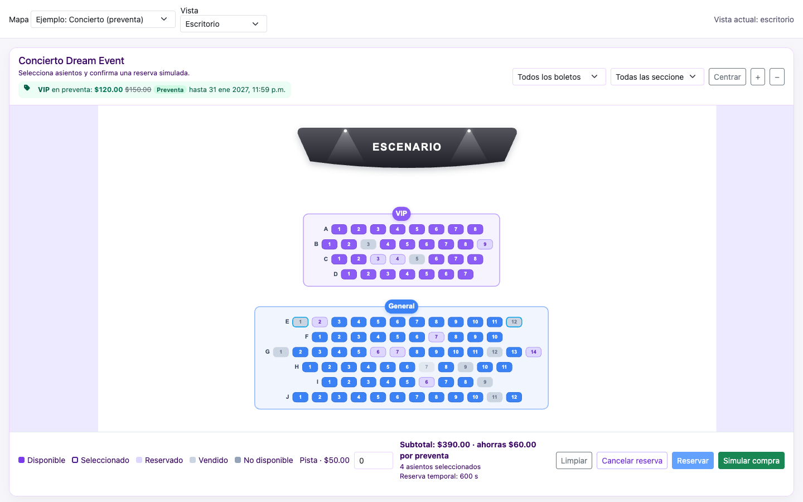

# Guía de compra: escritorio y móvil

El comprador ve el mapa que diseñó el organizador, elige asientos y boletos de admisión general, ve el total (con preventa si aplica) y crea una **reserva simulada** con temporizador.

Hay dos interfaces con **la misma lógica** (reglas, precios, reservas y callbacks):

| Clase | Dispositivo | Interfaz |
| --- | --- | --- |
| `DreamEventSeatSelector` | PC, laptop, iPad / tablets | Mapa grande, filtros por boleto y sección, barra inferior con total y botones. |
| `DreamEventSeatSelectorMobile` | Teléfonos | Mapa a pantalla completa con pellizco para zoom, chips de boletos y carrito en hoja inferior con un solo botón grande. |
| **`DreamEventSeatPicker`** (recomendado) | Todos | Elige la interfaz correcta y cambia sola si gira el teléfono o se redimensiona la ventana. |

| Escritorio | Móvil |
| --- | --- |
|  |  |

---

## 1. Instalación

```html
<link rel="stylesheet" href="https://cdnjs.cloudflare.com/ajax/libs/font-awesome/6.7.2/css/all.min.css">
<link rel="stylesheet" href="https://cdn.jsdelivr.net/npm/bootstrap@5.3.3/dist/css/bootstrap.min.css">
<link rel="stylesheet" href="css/dream-event-common.css">
<link rel="stylesheet" href="css/dream-event-selector.css">
<link rel="stylesheet" href="css/dream-event-mobile.css">
<meta name="viewport" content="width=device-width, initial-scale=1, viewport-fit=cover">

<div id="compra"></div>

<script src="https://cdn.jsdelivr.net/npm/sweetalert2@11"></script>  <!-- opcional: avisos en escritorio -->
<script src="https://cdn.jsdelivr.net/npm/konva@9.3.18/konva.min.js"></script>
<script src="js/dream-event-utils.js"></script>
<script src="js/dream-event-schema.js"></script>
<script src="js/dream-event-layout.js"></script>
<script src="js/dream-event-renderer.js"></script>
<script src="js/dream-event-seat-selector.js"></script>
<script src="js/dream-event-seat-selector-mobile.js"></script>
```

`viewport-fit=cover` hace que la versión móvil respete el notch y la barra inferior del iPhone.

```js
const compra = DreamEventSeatPicker.create({
  container: '#compra',
  data: mapa,                    // JSON del Builder
  availability: {                // estado en vivo, separado del mapa
    seats: { vip_A1: 'sold', vip_A2: 'held' },
    generalAdmission: { ticket_pista: { sold: 40, held: 5 } },
  },
  mode: 'auto',                  // 'auto' | 'mobile' | 'desktop'
  options: {
    maxSeats: 6,                 // boletos máximos por compra (asientos + admisión general)
    minSeats: 1,
    maxPerTicket: { ticket_vip: 4 },
    allowMultipleSections: true,
    allowNonConsecutiveSeats: true,
    holdDurationSeconds: 600,
    locale: 'es-MX',
    currency: 'MXN',
    now: () => horaDelServidor,  // para decidir la preventa (por defecto Date.now())
    height: '640px',             // solo móvil: alto del componente (por defecto la pantalla)
    minTapSize: 16,              // solo móvil: px mínimos del asiento para seleccionarlo
  },
  callbacks: {
    onModeChange(mode) {},       // 'mobile' | 'desktop'
    onReady(mapa) {},
    onSelectionChange(seleccion) {},
    onSeatSelected(asiento) {},
    onSeatDeselected(asiento) {},
    onHoldCreated(reserva) {},
    onHoldTick({ reservation, remainingMs }) {},
    onHoldExpired(reserva) {},
    onHoldCancelled(reserva) {},
    onPurchaseSimulated(reserva) {},
    onCheckout(seleccion) {},
    onError(error) {},
  },
});
```

También puedes crear una interfaz fija: `new DreamEventSeatSelector({...})` o `new DreamEventSeatSelectorMobile({...})`, con las mismas opciones.

---

## 2. Detección automática

`DreamEventSeatPicker.detectMode()` decide así:

| Dispositivo | Resultado |
| --- | --- |
| iPhone, Android con «Mobile», `navigator.userAgentData.mobile` | **móvil** |
| Pantalla táctil con lado corto < 600 px | **móvil** |
| Cualquier ventana con ancho < 640 px (p. ej. un navegador de escritorio angosto) | **móvil** |
| iPad (también iPadOS, que se presenta como Mac), tablets Android, PC y laptop | **escritorio** |

- Al girar el dispositivo o cambiar el tamaño de la ventana vuelve a evaluar y cambia de interfaz **conservando la selección**.
- Nunca cambia mientras hay una reserva activa.
- `compra.getMode()` devuelve el modo actual. `compra.setMode('mobile' | 'desktop' | 'auto')` lo fuerza o regresa a automático.
- El contenedor recibe `data-de-mode="mobile|desktop"` para estilos propios.

---

## 3. Flujo del comprador en móvil

| 1. Mapa | 2. Zoom y selección | 3. Carrito | 4. Reserva | 5. Compra |
| --- | --- | --- | --- | --- |
|  |  |  |  |  |

1. **Mapa a pantalla completa** con la preventa activa y chips por tipo de boleto (filtran el mapa y muestran el precio vigente).
2. **Pellizca** para hacer zoom o **toca dos veces**. Si los asientos se ven muy pequeños, el primer toque acerca el mapa a ese asiento en lugar de seleccionarlo, para evitar errores. Al elegir un asiento vibra (si el teléfono lo permite) y aparece un aviso con sección, fila y precio.
3. La **hoja inferior** muestra cuántos boletos llevas, el ahorro por preventa y el total. Tócala para ver el detalle, quitar asientos o sumar boletos de admisión general con − / +.
4. **Reservar** aparta los asientos y muestra la cuenta regresiva.
5. **Pagar** simula la compra: los asientos pasan a «vendido».

Los asientos vendidos o apartados no se pueden elegir y avisan por qué. Funciona igual con todos los templates, incluso anillos de estadio y mesas:



## 4. Flujo en escritorio / iPad



- Clic en asientos para elegir; la rueda del ratón hace zoom; arrastra para mover el mapa.
- Filtros por tipo de boleto y por sección, botones Centrar, + y −.
- Barra inferior: leyenda, cantidad de admisión general, subtotal con ahorro por preventa, **Limpiar**, **Reservar**, **Cancelar reserva** y **Simular compra**, más la cuenta regresiva.

---

## 5. Datos que devuelve

`getSelection()` (y `onSelectionChange`):

```json
{
  "eventId": "concierto_dream_event",
  "currency": "MXN",
  "seatCount": 2,
  "ticketCount": 3,
  "seats": [
    {
      "seatId": "vip_B4", "sectionId": "vip", "sectionName": "VIP",
      "rowId": "vip_row_B", "rowLabel": "B", "seatNumber": 4,
      "ticketTypeId": "ticket_vip", "ticketTypeName": "VIP",
      "unitPrice": 120, "regularPrice": 150, "pricing": "presale"
    }
  ],
  "generalAdmission": [
    { "ticketTypeId": "ticket_pista", "quantity": 1, "unitPrice": 50, "regularPrice": 50, "pricing": "regular", "subtotal": 50 }
  ],
  "subtotal": 290, "savings": 60, "total": 290
}
```

`createHold()` (y `onHoldCreated`) devuelve `reservationId`, `status`, `createdAt`, `expiresAt`, `durationSeconds`, `seatIds`, `seats` (con el precio congelado), `generalAdmission`, `total`, `savings`, `currency` y `simulated: true`.

---

## 6. Integración con tu servidor (recomendado)

```js
const compra = DreamEventSeatPicker.create({
  container: '#compra',
  data: await (await fetch('/api/eventos/123/mapa')).json(),
  availability: await (await fetch('/api/eventos/123/disponibilidad')).json(),
  options: { now: () => relojServidor() },
  callbacks: {
    async onHoldCreated(reserva) {
      // El servidor valida precios, preventa y disponibilidad y aparta de verdad.
      const r = await fetch('/api/reservas', { method: 'POST', body: JSON.stringify(reserva) });
      if (!r.ok) compra.cancelHold();
    },
  },
});

// Actualiza en vivo (WebSocket, polling…)
socket.on('asiento', ({ id, status }) => compra.updateSeatStatus(id, status));
```

El componente **no** cobra ni bloquea inventario para otros compradores; eso le toca a tu backend.

---

## 7. API

| Método | Descripción |
| --- | --- |
| `getSelection()`, `getSelectionJSON()`, `setSelection(sel)` | Leer o restaurar la selección. |
| `selectSeat(id)`, `deselectSeat(id)`, `toggleSeat(id)`, `clearSelection()` | Asientos. |
| `setGeneralAdmissionQuantity(ticketId, n)` | Admisión general. |
| `getTotal()` | Total en unidades mayores. |
| `getAvailability()`, `setAvailability(a)`, `updateSeatStatus(id, status)` | Disponibilidad en vivo (`available`, `held`, `sold`, `blocked`, `disabled`). |
| `createHold()`, `getHold()`, `getRemainingHoldTime()`, `cancelHold()`, `expireHold()` | Reserva local. |
| `simulatePurchase()`, `checkout()` | Compra simulada / emitir `onCheckout`. |
| `getData()`, `setData(mapa)` | Mapa. |
| `fitToScreen()`, `resize()`, `reset()`, `destroy()` | Vista y ciclo de vida. |
| Solo `DreamEventSeatPicker`: `getMode()`, `setMode(m)`, `instance` | Modo y acceso a la interfaz actual. |
| `DreamEventSeatPicker.detectMode()` | `'mobile'` o `'desktop'` para el dispositivo actual. |
